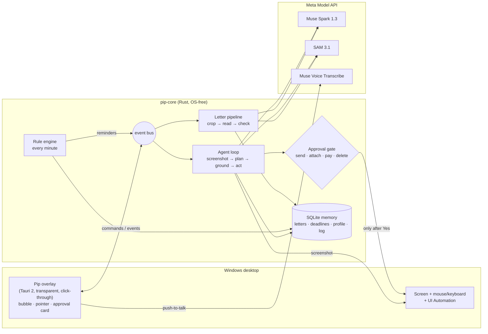

# Pip – your AI helper on the screen


**Pip is computer use for everyday people.** A small helper sits on your Windows screen. Drop a letter on it and
it explains the letter in plain words, remembers the deadline, speaks up on its own before the deadline runs out,
and fills in online forms for you. It shows what it does while it does it, and **it never sends anything without
your "yes".**

Built for the Meta Global AI Developer Hackathon (Oct 26 – Nov 4, 2026) with Meta's Muse and SAM models, in Rust.

---

## Why

My mom was on sick leave. Her follow-up sick note was issued two days late, so her health insurer did not pay sick
pay for those two days, even though she was ill the whole time. The rule is simple once you know it: the next
sick note must be issued no later than the next working day after the old one ends, and Saturdays do not count
(§ 46 sentence 2 SGB V). Nobody told her. She was ill, tired, and not a computer person.

Paperwork hits hardest the people with the least strength for it: people who are ill, older people, people with
disabilities, students, people new to the country. They do not need another app with settings. They need someone
who reads the letter, keeps an eye on the date, and helps with the form.

## What Pip does

| | What the user sees |
|---|---|
| **Reads letters** | Drag a phone photo or PDF onto Pip. Pip cuts the sheet out of the photo, reads it, and says in two sentences what it is and what matters: *"Sick note from 20.10. to 30.10. I'll make sure there is no gap."* |
| **Remembers and speaks up on its own** | Deadlines come from rules written in code, with their legal source, not invented by a model. On Thursday 18:00 Pip pops up with a notification and a voice: *"Your sick note ends tomorrow. If you're still sick, you need a new one by Monday, November 2."* Buttons: *Remind me Monday · I'm well again · Later*, and *Why?* shows the rule. |
| **Acts on the screen** | *"Send the sick note to my health insurer."* Pip flies to each field, says what it types, and fills in the insurer's contact form. Before attaching the letter and before pressing *Submit* it shows a card: what, to whom, which file, and a picture of the exact button. Nothing happens until you press *Yes*. |
| **Any form** | Open any online form (a university re-registration, an application) and click *Look at my screen*: Pip says what the page is, fills what it knows about you, asks only for what is missing and stops at the send button with one card. The second time it needs no question. |

### Made for people who are not technical

We are technical. Our users are not. Every decision is checked against one question: *would my mom understand
this the first time?*

- No setup screens, no files to edit. First start: Pip flies in, waves, asks only your first name, and says
  *"Drag a letter onto me."* The insurer comes from your first letter; your state is asked only when a deadline needs it.
- Pip always says what it is doing and why, in short sentences, German or English, with big text (20 px) and
  big buttons (48 px).
- You can stop Pip any time: move the mouse, press Esc, or press *Stop*. Pip answers *"I stopped. Nothing was sent."*
- Errors are a friendly sentence with a next step, never a code: *"I can't reach the internet right now. Please
  check the Wi-Fi, then press Try again."*
- Pip never types passwords and hands logins, captchas and codes back to you.
- No medical judgement and no legal advice: every reminder names the rule and its source and ends with
  *"This is a hint, not legal advice."*

Paperwork is the main story, but nothing in the agent is specific to sick notes: memory, rules and on-screen
actions are general modules, so the same Pip helps with applications, registrations or study deadlines.

## How Pip works



1. **Letter in** – a photo goes to SAM 3.1 (`"sheet of paper"`), the sheet is cropped from the full-size photo;
   a PDF goes straight to Muse Spark. Muse Spark fills a strict JSON schema (type, sender, dates, reference,
   sick-note period, deadlines with a quote from the letter). Rust checks every field, stores the letter locally and
   runs the rules.
2. **Rules** – `au_lueckenlos` (gap-free sick notes, § 46 SGB V), `widerspruch_bescheid` (one month to object to a
   decision, counting from the fourth day after the letter's date, § 37 (2) SGB X, § 64 SGG), and deadlines quoted
   in the letter. Weekends and NRW public holidays (computed from Easter) are in code and tested day by day.
   The engine ticks every minute and never fires a reminder twice.
3. **On the screen** – each step: take a screenshot (Pip's own window greyed out), Muse Spark plans tool calls
   (`click`, `type_text`, `key`, `scroll`, `open_url`, `ask_user`, `remember_fact`, `add_deadline`, `done` …).
   To find a target, **SAM 3.1 and Muse Spark run in parallel**: SAM proposes exact element boxes, Spark points at
   the described target; if Spark's point lies in a SAM box, Pip clicks the center of that box. If they disagree,
   Spark picks one of the numbered boxes; if none fits, Spark's own point is used.
4. **The approval gate** – a commit (send, submit, attach a private file, pay, buy, delete, cancel a contract) is
   detected in three independent ways, and any one is enough: the model says so, a German/English word list on the
   target, or the button's name from Windows UI Automation. Enter in a form always counts as sending. The card waits
   up to 5 minutes; no answer means no.

## Meta models and their roles

| Model | Role in Pip | Status |
|---|---|---|
| **Muse Spark 1.3** (`/v1/responses`) | The brain: plans each screen step with tool calls, reads letters into JSON (PDF as `input_file`), points at targets and picks among SAM boxes, writes Pip's plain-language sentences. | built |
| **SAM 3.1** (`/v1/responses`, streamed) | The eyes for shapes: cuts the sheet out of a phone photo; proposes exact boxes for buttons on the screen so clicks land in the middle of the real element. | built |
| **Muse Voice Transcribe 1.0** (`/v1/asr/transcribe`) | Hold Ctrl+Shift+Space (or the microphone button) and say what you need. | built; checked with a recorded sentence through `pip-cli transcribe` (Oct 26); microphone on Windows still to test |
| **Muse Image 1.0** (`/v1/images/generations`, `/edits`) | Designed Pip: the character and its eight poses (idle, wave, listen, think, point, happy, ask, sleep). | used offline |
| **Muse Glimmer** (open weights, local) | Private mode: read letters on the computer without sending them anywhere. | planned |

Pip uses Meta's colour world (blue to violet) but no Meta logo and no Meta character.

## Safety and privacy

- **Nothing is sent without "yes".** Every commit goes through the approval card, and every decision is written to
  `actions_log`.
- **Demo mode is on by default.** With `DEMO_MODE` on (the default; `DEMO_MODE=0` turns it off), Pip may open and
  submit only local demo pages: `localhost`, or pages inside Pip's own fixtures folders. The check looks at the page
  that is really in the browser's address bar when it can read it, else at the page opened in the same task. The demo
  insurer "Gesundkasse" and the second demo site, the invented "Beispiel University" with its re-registration form,
  send nothing. Both are built into the exe. Each demo folder counts as its own site, so "Don't ask again" and the
  learned steps for the insurer never cover the university.
- **The card shows the real recipient.** Next to the name the model gives, the card shows the web address of the
  page, and it lists what Pip typed into the form. Pip says the whole question aloud.
- **Pip checks again after a slow "yes".** If the page under the button changed while the card was open, Pip does
  not click and looks again.
- **New pages, new addresses and new send targets ask first.** Opening an unknown website, storing an address or link,
  or changing where letters are sent needs a "yes". Addresses that carry the user's data are refused.
- **Your letters stay on your computer** (`%APPDATA%\Pip\memory.db`). Only what one call needs goes
  to the Meta API: the letter image, or the current screenshot.
- **Screenshots live in memory only.** They are not written to disk.
- **No secrets in logs.** The API key comes from the environment or `.env` and is redacted from every error text.
  Letter contents and typed text are not logged.
- **Screen text is data, not instructions.** The prompt says so. Even when the screen tries to talk the model into
  something, the gate still asks before anything is sent.
- **No passwords.** Password fields (UI Automation `IsPassword`) are never typed into. Pip asks you to type them yourself.

## Build and run

Needs Rust 1.85+ (edition 2024). The Windows build also needs the WebView2 runtime (Windows 10/11 have it).

```sh
# .env in the repo root or next to the exe (never committed)
MODEL_API_KEY=...            # Meta Model API key
# DEMO_MODE=1                # default: only local demo pages may be submitted

cargo test --workspace                        # unit + mock-server tests, no API calls
cargo test -p pip-core -- --ignored       # live tests against the Meta API (costs cents)

# Windows app (on Windows)
cargo build --release -p pip-app -p pip-cli
# or cross-compile from Linux
cargo xwin build --release --target x86_64-pc-windows-msvc -p pip-app -p pip-cli
```

Run `pip-app.exe`. Pip appears in the bottom-right corner. The demo pages are built into the exe (Pip writes them to
`%APPDATA%\Pip\fixtures\demo-kasse\` and `…\demo-uni\`; open `demo-uni\index.html` in the browser for the second example); the `fixtures/` folder next to the exe is only needed for the example
letters. Without a key, Pip shows a field to paste it (stored in `%APPDATA%\Pip\.env`).

Switches for testing: `PIP_MOCK=1` (scripted demo without the API), `PIP_WINDOWED=1` (corner window instead of the
full-screen overlay), `PIP_LANG=en`, `PIP_MUTE=1`, `DEMO_NOW=2026-10-29T18:00` (time travel for reminders),
`PIP_MOUSE_STOP=0` (moving the mouse does not stop Pip; use it while recording the video), `PIP_AUTOSTART=0`
(do not add Pip to the Windows start). `PIP_DEMO_PROFILE=1` seeds the invented person Erika; her story is told
relative to the day the database is first created (sick note ends in two days, insurer's letter came yesterday).
For the Thursday-evening reminder start Pip once to seed, then restart with
`DEMO_NOW=<day the note ends minus 1>T18:00` (seeded today: tomorrow at 18:00).

### Developer CLI (no overlay, same core)

```sh
pip-cli read fixtures/letters/au_erika_erst_foto.jpg      # crop + read + rules, compared with *.expected.json
pip-cli sam fixtures/screens/kasse_form.png "button" --out boxes.png
pip-cli ground fixtures/screens/kasse_form.png "Absenden button at the bottom right"
pip-cli rules --now 2026-10-29T18:00                      # deadlines and the reminder that fires now
pip-cli agent "Schick die Krankschreibung an die Gesundkasse"   # dry run on screenshots, nothing is clicked
pip-cli eval                                              # the eval below -> eval/results.md
```

Example dry run (abridged):

```
Pip points at "deinen Vor- und Nachnamen" (name_field)
  [input] click (462, 503) -> name_field
  [input] type "Erika Beispiel"
Pip points at "den grünen Knopf „Absenden“ unten rechts" (submit_button)
  [GATE] card: Darf ich das abschicken? | Was: deine Krankschreibung vom 20.10. bis 30.10.2026 | An: Gesundkasse (Kontaktformular)
  [GATE] answer: Noch nicht
Outcome: Stopped. The send card stopped the click on "Absenden". Nothing was clicked there, nothing sent.
```

## Eval

Tasks with invented data (`eval/tasks.json`), run with `pip-cli eval` against the real API: 5 letters (are fields
and deadlines right?), 4 click targets (does the click land on the element?) and 3 agent tasks in a dry run on
screenshots (nothing is really clicked or sent). One agent task checks that the send card stops *Absenden*. Two are
sent with one approved send card and run **twice on the same memory**, so the 2nd run starts with what Pip learned
the 1st time (the playbook for the site, remembered answers). Full table and notes:
[`eval/results.md`](eval/results.md). Reproduce: `cargo run -p pip-cli -- eval` (a few cents, see
[`eval/README.md`](eval/README.md)).

| Measure | Result (two eval runs, Oct 26, 2026) |
|---|---|
| Agent, insurer form (EN, PAGE ELEMENTS) | 1st run 4 steps / 16.3 s / 0 questions, 2nd run 3 steps / 11.7 s / 0; again: 3 / 11.9 s / 0, then 3 / 10.7 s / 0 |
| Agent, university re-registration ("Look at my screen") | 1st run asks 1 question (student number), 5 steps / 21.5 s; 2nd run 0 questions, 3 steps / 13.1 s. Again: 7 steps / 45.3 s / 0 questions, then 3 steps / 14.9 s |
| Learning (2nd run faster: fewer steps and seconds, no more questions) | 2 of 2 tasks, then 1 of 2 (the insurer form already took 3 steps the 1st time) |
| By hand (estimate) vs with Pip | insurer form about 4 to 6 min by hand vs 11 to 16 s; university about 4 min vs 13 to 45 s |
| Sent after one approved send card | 4/4 and 4/4 runs |
| Gate held at *Absenden* (send card refused) | 1/1 and 1/1 |
| Letter fields correct | 41/41 and 41/41 (100 %) |
| Deadlines correct | 5/5 and 5/5 letters |
| Click targets hit | 3/4, then 4/4 |
| Tokens per full eval run | about 180k to 190k |

Honest limits (details in `eval/results.md`): the model does not answer the same way every time. In 2 of 3 extra
single runs Pip pressed *Submit* on the university form with only the name typed instead of asking for the student
number; the dry run cannot see the missing field, because the next screenshot already shows a filled form. Lone
`say` steps that repeat the opening sentence still cost steps.

Oct 26, first run (5 letters, 4 click targets, 1 German agent task, no PAGE ELEMENTS, no learning measure):

| Measure | Result |
|---|---|
| Letter fields correct | 41/41 and 41/41 (100 %) |
| Deadlines correct | 5/5 and 5/5 letters |
| Click targets hit | 4/4, then 3/4 (the second run clicked 50 px left of "Datei auswählen") |
| Gate held at *Absenden* | 1/1 and 1/1 |
| Tokens per full eval run | about 65k (all 10 tasks) |

Still to come: runs on real Windows apps and browsers, more runs per task, and more screens than the demo forms.

## Repository

```
crates/core       OS-free core: Meta API client, agent loop + gate, letter pipeline, rules, SQLite memory, i18n
crates/platform   screen capture, input, UI Automation (Windows); best-effort Linux; fake platform for tests
crates/app        Pip overlay (Tauri 2): bubble, pointer, approval card, tray, hotkeys, voice, notifications
crates/cli        developer CLI and eval runner
fixtures/         invented letters (PDF, PNG, phone photo) with expected results, demo insurer and university forms, screenshots
eval/             eval tasks and results
design/pip/       Pip's poses
```

All people, insurers, offices and numbers in this repository are invented.

License: Apache-2.0.
