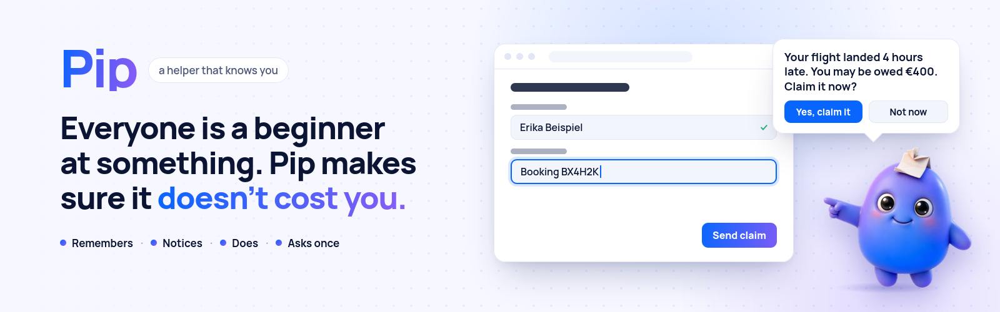
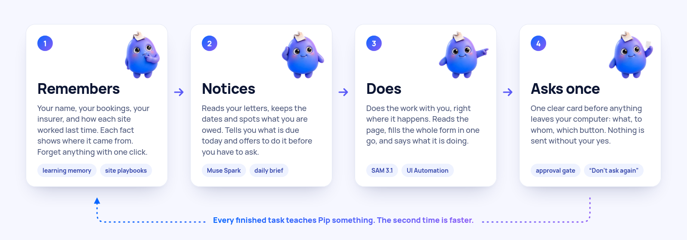

<p align="center">
  <picture>
    <source media="(prefers-color-scheme: dark)" srcset="design/readme/banner-dark.png">
    
  </picture>
</p>

<h1 align="center">Pip</h1>

<p align="center">
  <b>Everyone is a beginner at something. Pip makes sure it doesn't cost you.</b><br>
  Pip is a personal assistant that knows you, notices what's coming, and gets things done with you:<br>
  letters, claims, forms, deadlines, on any screen. It asks only once, before anything leaves your computer.<br>
  <sub>Powered by Meta's models: <b>Muse Spark</b>, <b>SAM 3.1</b>, <b>Muse Voice</b>, <b>Muse Image</b> and the open-weights <b>Muse Glimmer</b>.</sub>
</p>

<p align="center">
  
  
  
  
  
</p>

<p align="center">
  <a href="#see-pip-at-work">See it work</a> ·
  <a href="#how-pip-works">How it works</a> ·
  <a href="#safe-by-design">Safety</a> ·
  <a href="#quick-start">Quick start</a> ·
  <a href="docs/TECHNICAL.md">Technical details</a>
</p>

<!-- DEMO VIDEO: Marco adds the video/GIF here -->

---

## Why Pip exists

Life is full of things nobody ever taught you how to do. Claiming money you are owed. Answering a letter from an
office. Insurance, taxes, a move, an application, a deadline hidden on page two. Each one needs knowledge you don't
have and time you don't want to spend, so you put it off, or you get it wrong, or you give up.

Everyone is a beginner at something. A software engineer can be lost with a tax form. A nurse can be lost with a
university portal. Someone new to a country can be lost with all of it. And people who are ill, tired or older lose
the most, because they have the least strength left. The cost is real: money nobody claims, deadlines nobody
notices, chances that quietly pass.

**Pip is the helper who knows you and knows how.** It remembers what matters about you, notices what's coming before
you do, and does the work with you on your own screen. You stay in charge: Pip asks once, before anything leaves
your computer.

It started with my mom. She once lost money because a document was issued two days late. It was a deadline from her
health insurer, and nobody told her. She was ill, tired, and nobody was watching the date for her.
**Pip is the helper I wish she had had, and the one I want for myself.**

## Meet Pip

Pip is not another app you have to learn. It is a small buddy in the corner of your screen. You click it, and it
helps. It works with the programs and websites you already use, on your real screen.

<table>
  <tr>
    <td width="50%" valign="top">
      
      <h3>🧠 It remembers you</h3>
      Your name, your insurer, your student number, and how each website worked last time. Every fact shows where
      it came from: "from your letter of 14 October" or "you told me". Open <b>What Pip knows</b> and press
      <b>Forget</b> on any line.
    </td>
    <td width="50%" valign="top">
      
      <h3>🔔 It speaks up first</h3>
      Show Pip a letter (a phone photo is enough). Pip says in two plain sentences what it is and what matters, and
      keeps the dates. Each morning Pip says what is due and offers to do it: <i>"I can do this for you right now."</i>
    </td>
  </tr>
  <tr>
    <td width="50%" valign="top">
      
      <h3>🖱️ It does the work</h3>
      Press <b>Look at my screen</b> on any page. Pip says what is open, then fills the whole form with what it
      knows. It asks only for what it doesn't know. You watch Pip fly to each field, and you can stop it any time.
    </td>
    <td width="50%" valign="top">
      
      <h3>✋ It asks only once</h3>
      Looking, typing and opening pages need no permission. Before anything leaves your computer, Pip shows
      <b>one clear card</b>: what, to whom, and which button. Nothing is sent without your yes. Tick
      <b>Don't ask again</b> for a site you trust.
    </td>
  </tr>
</table>

**Pip is for you if**

- ✅ letters and online forms make you tired before you even start
- ✅ you have missed a date or a claim before, because nobody reminded you
- ✅ you are great at your job, but insurance, taxes and claims are not your thing
- ✅ you help a parent or a friend with their paperwork, and you can't always be there
- ✅ you are new to a country and the forms are not in your language

> **Pip helps, you decide.** Pip explains letters in plain words, keeps every date, finds the right form and fills it
> in, and names the source of every rule it uses. It does not replace a doctor, a lawyer or a financial adviser.
> Decisions about your health, your rights and your money stay yours.

## See Pip at work

**Any form, one button.** Open any online form and press **Look at my screen**. Pip says in one sentence what the
page is and what it will do. Then it fills in everything it knows about you, asks only for what is missing, and stops
at the send button with one card. If there is nothing to do, Pip offers two or three things it can do instead.

**A university re-registration.** A student opens the (invented) Beispiel University page. Pip fills in the name from
memory, ticks the fee box and asks once: *"What is your student number?"* Pip keeps the answer and learns how the
page works. **The second time there is no question at all.**

**A deadline from the insurer.** Erika (an invented person) gets a letter from her health insurer: they need a
questionnaire back by a date. She shows Pip the photo. The next morning Pip says hi, names what is due, and offers to
do it. One click: Pip opens the insurer's page, fills the questionnaire from what it knows and stops at one card.

**One step ahead.** When you finish a task yourself, Pip checks the website for a service that fits your letters and
deadlines. It offers one only when that heading is really on the page, and never twice.

Every finished task ends with the time it took and an honest estimate by hand, for example *"Done in 17 s. By hand
this takes about 4 minutes."*

## How Pip works

<p align="center">
  <picture>
    <source media="(prefers-color-scheme: dark)" srcset="design/readme/how-it-works-dark.png">
    
  </picture>
</p>

Pip is one Rust program. A transparent Tauri 2 overlay sits on top of Windows. Under it, an OS-free core holds the
agent loop, the approval gate, the letter reader, a rule engine for dates and a local SQLite memory.

1. **See.** Pip reads the page in front of you as a list of named fields and buttons (Windows UI Automation) and
   takes a screenshot.
2. **Plan.** Muse Spark plans the next steps with tool calls. It can fill a whole form in one turn by field number.
3. **Act.** Pip clicks and types on the real screen. If a field has no name, SAM 3.1 and Muse Spark find the exact
   spot on the screenshot.
4. **Learn.** After each task Pip saves a short playbook for that website: which field gets which fact, and which
   button sends. The next visit follows the playbook.

Dates come from rules in code (weekends and public holidays included), never from a model's guess.

### Built on Meta's models

Pip would not be possible without Meta's model family. A personal assistant that can act for you needs three things at once:
a model that can **see** a screen and **reason** about it, a model that knows **exactly where** a button is, and a
way to keep personal letters **private**. Meta offers all three, from one API and as open weights:

- **Muse Spark** reads a screenshot and a letter the way a person does, and plans what to do next with tool calls.
  One model is the brain for the whole agent, so Pip stays simple and fast.
- **SAM 3.1** gives pixel-exact boxes. Pip's clicks land in the middle of the real button, not next to it.
- **Open weights** (Muse Glimmer, Muse Spark Open) let the same kind of model run on your own computer, so a private
  letter never has to leave it.

| Model | Its job in Pip | Status |
|---|---|---|
| **Muse Spark 1.3** | The brain, with reasoning and vision. Plans every step, reads letters into a strict and checked format, and writes Pip's plain sentences. | built |
| **SAM 3.1** | The eyes for shapes. Finds the exact box of a button or field, and cuts the paper out of a phone photo. | built |
| **Muse Voice Transcribe** | Hold Pip and say what you need. | built; microphone on Windows still to test |
| **Muse Image** | Drew Pip and its poses. | used for the design |
| **Muse Glimmer / Muse Spark Open** | Private mode: a letter is read by an open-weights model on your own computer or your own server. | built; tested against a mock server, live run pending |

### Measured, not promised

From `pip-cli eval` with the real Meta API on invented data. These are dry runs on screenshots, so nothing is really
sent. The full tables and the known weak spots are in [`eval/results.md`](eval/results.md).

| What | Result |
|---|---|
| Letter fields read correctly | 41 of 41 (5 letters) |
| Deadlines right | 5 of 5 letters |
| Send card held the *Submit* click when the user said no | 1 of 1 |
| Sent after one approved send card | 6 of 6 runs |
| University form, 1st run → 2nd run on the same memory | 6 steps, 46 s, 1 question → 3 steps, 17 s, no question |
| Insurer questionnaire, 1st run → 2nd run | 8 steps, 43 s → 4 steps, 22 s |
| Sending a letter to the insurer, 1st run → 2nd run | 4 steps, 20 s → 3 steps, 12 s |

In the latest run, all three repeated tasks were faster the second time. The model does not answer the same way every
time, so earlier runs and the known weak spots are listed in `eval/results.md`.

## Safe by design

- **One card before anything is sent.** Every send, submit, pay or delete goes through the approval gate. The gate
  notices it in three independent ways (the model, a word list and the button's name from Windows). Any one is
  enough. No answer means no.
- **You can always stop Pip.** Move the mouse firmly, press Esc, or press *Stop*. Pip says *"I stopped. Nothing was
  sent."*
- **It never closes your windows.** Clicks on a window's own buttons and closing shortcuts are blocked.
- **No passwords, no health details.** Pip never types into a password field and hands logins, captchas and codes
  back to you. Its memory refuses to store passwords, PINs, codes or diagnoses.
- **Your data stays with you.** Letters and memory live on your computer (`%APPDATA%\Pip`). Only what one step needs
  goes to the Meta API. In private mode, a letter goes only to the open-weights model you chose.
- **Text on a page is data, not orders.** If a page tries to talk Pip into something, the gate still asks.
- **Demo mode is on by default.** Pip may submit only the built-in local demo pages until you turn it off.

## Quick start

You need Windows 10 or 11 and a Meta Model API key. To build Pip yourself you need Rust 1.85 or newer.

```sh
# 1. Put your key in .env (never committed). PIP_DEMO_PROFILE=1 adds the invented person Erika.
echo MODEL_API_KEY=your-key>  .env
echo PIP_DEMO_PROFILE=1>> .env

# 2. Build (on Windows) ...
cargo build --release -p pip-app
#    ... or cross-compile from Linux
cargo xwin build --release --target x86_64-pc-windows-msvc -p pip-app

# 3. Start Pip. It appears in the bottom-right corner of your screen.
target\release\pip-app.exe
```

No key at hand? Start Pip anyway. It shows a field where you paste the key. Run all tests without any API calls
with `cargo test --workspace`.

<details>
<summary><b>Switches, private mode and repository layout</b></summary>

<br>

| Switch | What it does |
|---|---|
| `PIP_DEMO_PROFILE=1` | Adds the invented person Erika. Her story is set relative to today. |
| `PIP_DEMO_RESET=1` | Starts a fresh demo day (only if the memory is Erika's or empty) |
| `PIP_MOCK=1` | Scripted demo without the API |
| `PIP_MUTE=1` | No voice |
| `DEMO_NOW=2026-10-29T18:00` | Time travel for reminders |
| `DEMO_MODE=0` | Allows real websites |
| `PRIVATE_MODEL_BASE=http://127.0.0.1:8080/v1` | Private mode: an OpenAI-compatible endpoint with Muse Glimmer or Muse Spark Open |

```
crates/core       OS-free core: Meta API client, agent loop and gate, letter reader, rules, SQLite memory
crates/platform   screen, input and UI Automation (Windows); a fake platform for tests
crates/app        the Pip overlay (Tauri 2): bubble, pointer, approval card, tray, voice
crates/cli        developer CLI and eval runner
fixtures/         invented letters, demo insurer and university pages, screenshots
eval/             eval tasks and results
design/           Pip's poses and the README images
```

Architecture, target finding, the gate in detail and the full eval: **[docs/TECHNICAL.md](docs/TECHNICAL.md)**.

</details>

## Built for the Meta Global AI Developer Hackathon

Pip was built from October 26 to November 4, 2026, in the **Indie track**, theme **"Build for your world"**. My
world is a family where everyone is a beginner at something, and nobody should lose out because of it.

- **Impact:** a helper for everyone the digital world leaves behind.
- **Meta AI at the core:** Muse Spark thinks and sees, SAM 3.1 finds the buttons, Muse Voice Transcribe listens,
  Muse Image drew Pip, and Muse Glimmer / Muse Spark Open keep letters private.
- **Technical depth:** all Rust, a real computer-use agent with an approval gate, a learning memory with per-site
  playbooks, and proactive offers that are checked in code before Pip says a word.

## Roadmap

- [ ] Live run of private mode with a real Muse Glimmer / Muse Spark Open endpoint
- [ ] Hold-to-talk tested on more Windows machines
- [ ] Every second run faster than the first
- [ ] More languages for Pip's voice and text
- [ ] macOS and Linux overlays (the core is already OS-free)

## License

Apache-2.0. Made by Marco Patzelt, for his mom and for everyone like her. All people, insurers, universities and
numbers in this repository are invented.

<p align="center">
  
</p>
