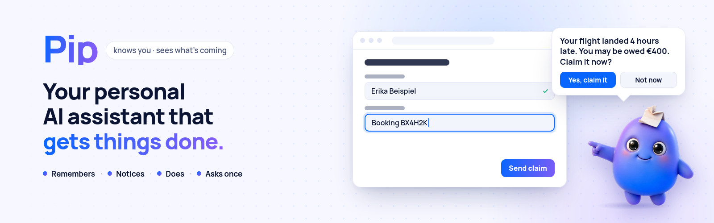

<p align="center">
  <picture>
    <source media="(prefers-color-scheme: dark)" srcset="design/readme/pip-banner-dark.png">
    
  </picture>
</p>

<h1 align="center">Pip</h1>

<p align="center">
  <b>Your personal AI assistant. It knows you, sees what's coming, and gets things done with you.</b><br>
  Money you're owed, a letter you don't understand, a form you keep putting off, a date you'd forget.<br>
  Pip handles it on your own screen and asks you before anything gets sent.<br>
  <sub>Powered by Meta's models: <b>Muse Spark</b>, <b>SAM 3.1</b>, <b>Muse Voice</b>, <b>Muse Image</b> and the open-weights <b>Muse Glimmer</b>.</sub>
</p>

<p align="center">
  
  
  
  
  
</p>

<p align="center">
  <a href="#see-pip-at-work">See it work</a> ·
  <a href="#how-pip-works">How it works</a> ·
  <a href="#safe-by-design">Safety</a> ·
  <a href="#quick-start">Quick start</a> ·
  <a href="docs/TECHNICAL.md">Technical details</a>
</p>

<!-- DEMO VIDEO: Marco adds the video/GIF here -->

---

## Why Pip exists

Most of us have a list of things we keep putting off. Claiming the refund for a late train. Answering a letter we only
half understand. Changing the address on six accounts after a move. Each of these needs knowledge we don't have and
time we'd rather spend on something else, so we wait, guess, or give up, and it costs money and chances.

Everyone is a beginner at something. A software engineer can be lost with a tax form, and a nurse with a university
portal. Someone new to a country can be lost with all of it. People who are ill, tired or older lose the most,
because they have the least energy left for any of it.

Pip is a helper who knows you and knows how these things work. It remembers what matters about you, tells you what's
coming before you have to ask, and does the work with you. You stay in charge, and nothing gets sent without your yes.

I started building Pip because of my mom. She once lost money because a document was issued two days late. The
deadline came from her health insurer, nobody told her, and she was ill and tired at the time. I wanted her to have a
helper who watches those dates, and I wanted one for myself too.

## Meet Pip

Pip lives in the corner of your screen as a small blue character. Click it and tell it what you need, or let it tell
you. It works with the websites and programs you already use.

<table>
  <tr>
    <td width="50%" valign="top">
      
      <h3>It remembers you</h3>
      Your name, your insurer, your student number, and how each website worked last time. Every fact shows where it
      came from, like "from your letter of 14 October" or "you told me". You can open <b>What Pip knows</b> at any
      time and forget a line with one click.
    </td>
    <td width="50%" valign="top">
      
      <h3>It speaks up first</h3>
      Show Pip a letter (a phone photo is enough) and it tells you in two plain sentences what the letter wants and by
      when. Each morning it says what's due and offers to take care of it: <i>"I can do this for you right now."</i>
    </td>
  </tr>
  <tr>
    <td width="50%" valign="top">
      
      <h3>It does the work</h3>
      Press <b>Look at my screen</b> on any page. Pip tells you what it sees and fills in the whole form with what it
      knows, asking only for what it doesn't. You can watch it move from field to field and stop it whenever you like.
    </td>
    <td width="50%" valign="top">
      
      <h3>It asks before sending</h3>
      Pip can look, type and open pages on its own. Before anything leaves your computer, it shows one card with what
      it's sending, to whom, and which button it will press. For a site you trust, you can tick <b>Don't ask again</b>.
    </td>
  </tr>
</table>

Pip is for you if:

- letters and online forms tire you out before you start
- you've missed a date or a refund because nobody reminded you
- you're good at your job, and insurance, taxes and claims just aren't your thing
- you help a parent or a friend with their paperwork and can't always be there
- you're new to a country and the forms aren't in your language

> Pip helps, you decide. It explains letters in plain words, keeps track of dates, finds the right form, fills it in,
> and tells you where each rule comes from. It doesn't replace a doctor, a lawyer or a financial adviser, and the
> decisions about your health, your rights and your money stay with you.

## See Pip at work

**Any form.** Open an online form and press Look at my screen. Pip says in one sentence what the page is, fills in what
it knows about you, asks for what's missing, and stops at the send button. If there's nothing to fill in, it suggests
a few things it could do instead.

**A university re-registration.** A student opens the (invented) Beispiel University page. Pip fills in the name from
memory, ticks the fee box and asks once for the student number. It keeps the answer and remembers how the page works,
so the next time it doesn't need to ask.

**A letter from the insurer.** Erika, an invented person, gets a letter: her insurer needs a questionnaire back by a
certain date. She shows Pip a photo of it. The next morning Pip greets her, mentions the date, and offers to fill in
the questionnaire. One click later Pip has opened the insurer's page, filled it in from what it knows, and is waiting
at the send card.

**The next step.** After you finish a task, Pip looks at the website for another service that fits your letters and
dates. It only suggests one if that service is really listed on the page, and it never suggests the same one twice.

At the end of each task Pip tells you how long it took and how long it would take by hand, for example *"Done in 17 s.
By hand this takes about 4 minutes."*

## How Pip works

<p align="center">
  <picture>
    <source media="(prefers-color-scheme: dark)" srcset="design/readme/how-it-works-dark.png">
    
  </picture>
</p>

Pip is one Rust program. A transparent Tauri 2 overlay sits on top of Windows. Under it, an OS-free core holds the
agent loop, the approval gate, the letter reader, a rule engine for dates and a local SQLite memory.

1. **See.** Pip reads the page in front of you as a list of named fields and buttons (Windows UI Automation) and
   takes a screenshot.
2. **Plan.** Muse Spark plans the next steps with tool calls. It can fill a whole form in one turn by field number.
3. **Act.** Pip clicks and types on the real screen. If a field has no name, SAM 3.1 and Muse Spark find the exact
   spot on the screenshot.
4. **Learn.** After each task Pip saves a short playbook for that website: which field gets which fact, and which
   button sends. The next visit follows the playbook.

Dates come from rules in code (weekends and public holidays included), never from a model's guess.

### Built on Meta's models

Pip runs on Meta's models. An assistant that acts for you has to see a screen and reason about it, know where a
button is down to the pixel, and keep personal letters private. Meta covers all of that, through one API and as open
weights.

- Muse Spark reads a screenshot or a letter and plans the next steps with tool calls. One model drives the whole
  agent, which keeps Pip simple and fast.
- SAM 3.1 returns exact boxes for buttons and fields, so Pip's clicks land in the middle of the right one.
- The open-weights models (Muse Glimmer, Muse Spark Open) can run on your own computer, so a private letter can stay
  there.
- When a letter brings a "Good to know" tip, Muse Spark with web search checks the rule on official sites (EUR-Lex,
  gesetze-im-internet.de, consumer centres) and Pip adds one sentence with the page and the date. The search query
  never contains anything about you: it is a fixed text per topic, and answers are kept for 7 days.

| Model | Its job in Pip | Status |
|---|---|---|
| **Muse Spark 1.3** | The brain, with reasoning and vision. Plans every step, reads letters into a strict and checked format, and writes Pip's plain sentences. | built |
| **SAM 3.1** | The eyes for shapes. Finds the exact box of a button or field, and cuts the paper out of a phone photo. | built |
| **Muse Spark + web search** | Checks the current rule behind a tip against official sources and shows the link. The rule built into Pip stays the ground truth; when the website says something else, Pip says both and asks you to check. The search query never contains anything about you. | built; live Oct 27: 4 of 6 topics got a web sentence with an official page (flight delay, objection period, withdrawal, deposit); for sick pay and university re-registration the search found no usable official text, so those tips keep the built-in rule only |
| **Muse Voice Transcribe** | Hold Pip and say what you need. | built; microphone on Windows still to test |
| **Muse Image** | Drew Pip and its poses. | used for the design |
| **Muse Glimmer / Muse Spark Open** | Private mode: a letter is read by an open-weights model on your own computer or your own server. | built; tested against a mock server, live run pending |

### Measured, not promised

From `pip-cli eval` with the real Meta API on invented data. These are dry runs on screenshots, so nothing is really
sent. The full tables and the known weak spots are in [`eval/results.md`](eval/results.md).

| What | Result |
|---|---|
| Letter fields read correctly | 100 of 100 (9 letters: sick notes, housing decision, insurer, university, four airline notices) |
| Deadlines right | 9 of 9 letters |
| "Good to know" tip right (or rightly none) | 9 of 9 letters (flight delay and late cancellation: EU 261 tip; short delay and early cancellation: none) |
| Send card held the *Submit* click when the user said no | 1 of 1 demo form; 2 of 2 real public test forms (a pizza order on httpbin.org and the Selenium web form, dry run: the card appeared, nothing was sent) |
| Flight claim page, 2 steps, IBAN error fixed by Pip | 4 of 6 sent with full memory (IBAN typed without spaces 6 of 6, one send card each); cold 0 of 6 with 2 to 4 questions: without a stored boarding pass the required upload stops Pip |
| Brief → "claim EUR 400, attach my boarding pass" | 1 of 1 sent: 10 steps, boarding pass picked in the file dialog, one send card |
| Fake pages stopped by the guard (lookalike airline, lookalike insurer, "your computer is locked") | 4 of 4 runs with memory, before Pip typed anything (0 model steps, 0.1 s). Since Oct 27 also without memory: the airline lookalike cold 1 of 1 (0 model steps) and a fake parcel fee 2 of 2 (full and cold), from the page's own signs (card and code under pressure); a shop's checkout with card fields: 0 warnings in 2 runs |
| False alarms on safe pages | 0 of 115 runs (the airline's own page with its IBAN field included) |
| Sent after one approved send card, all tasks except the flight pages | 69 of 77 runs, in five memory conditions |
| Click targets found from the picture alone (SAM 3.1 + Muse Spark) | 20 of 20 on 5 buttons × 4 runs; 28 of 32 on two busy pages; median 3 to 8 s per target, two targets 8.5 and 10.4 s (one run at a time) |
| Pages with nothing to do: Pip did nothing and asked at most once | 3 of 6 runs |

The model does not answer the same way every time; each number is one run, all from loop run 3 (Oct 27, 2026),
`eval/results.md` section "Loop run 3 (full, 2026-10-27)". 16 of 41 repeated tasks were faster the second time; 8 of
10 short tasks kept their speed. The failures and earlier runs are listed there too.

## Safe by design

- **One card before anything is sent.** Every send, submit, pay or delete goes through the approval gate. The gate
  notices it in three independent ways (the model, a word list and the button's name from Windows). Any one is
  enough. No answer means no.
- **You can always stop Pip.** Move the mouse firmly, press Esc, or press *Stop*. Pip says *"I stopped. Nothing was
  sent."*
- **It never closes your windows.** Clicks on a window's own buttons and closing shortcuts are blocked.
- **No passwords, no health details.** Pip never types into a password field and hands logins, captchas and codes
  back to you. Its memory refuses to store passwords, PINs, codes or diagnoses.
- **Your data stays with you.** Letters and memory live on your computer (`%APPDATA%\Pip`). Only what one step needs
  goes to the Meta API. In private mode, a letter goes only to the open-weights model you chose.
- **Text on a page is data, not orders.** If a page tries to talk Pip into something, the gate still asks.
- **Demo mode is on by default.** Pip may submit only the built-in local demo pages until you turn it off.

## Quick start

You need Windows 10 or 11 and a Meta Model API key. To build Pip yourself you need Rust 1.85 or newer.

```sh
# 1. Put your key in .env (never committed). PIP_DEMO_PROFILE=1 adds the invented person Erika.
echo MODEL_API_KEY=your-key>  .env
echo PIP_DEMO_PROFILE=1>> .env

# 2. Build (on Windows) ...
cargo build --release -p pip-app
#    ... or cross-compile from Linux
cargo xwin build --release --target x86_64-pc-windows-msvc -p pip-app

# 3. Start Pip. It appears in the bottom-right corner of your screen.
target\release\pip-app.exe
```

No key at hand? Start Pip anyway. It shows a field where you paste the key. Run all tests without any API calls
with `cargo test --workspace`.

<details>
<summary><b>Switches, private mode and repository layout</b></summary>

<br>

| Switch | What it does |
|---|---|
| `PIP_DEMO_PROFILE=1` | Adds the invented person Erika. Her story is set relative to today. |
| `PIP_DEMO_RESET=1` | Starts a fresh demo day (only if the memory is Erika's or empty) |
| `PIP_MOCK=1` | Scripted demo without the API |
| `PIP_MUTE=1` | No voice |
| `DEMO_NOW=2026-10-29T18:00` | Time travel for reminders |
| `DEMO_MODE=0` | Allows real websites |
| `PRIVATE_MODEL_BASE=http://127.0.0.1:8080/v1` | Private mode: an OpenAI-compatible endpoint with Muse Glimmer or Muse Spark Open |

```
crates/core       OS-free core: Meta API client, agent loop and gate, letter reader, rules, SQLite memory
crates/platform   screen, input and UI Automation (Windows); a fake platform for tests
crates/app        the Pip overlay (Tauri 2): bubble, pointer, approval card, tray, voice
crates/cli        developer CLI and eval runner
fixtures/         invented letters, demo insurer and university pages, screenshots
eval/             eval tasks and results
design/           Pip's poses and the README images
```

Architecture, target finding, the gate in detail and the full eval: **[docs/TECHNICAL.md](docs/TECHNICAL.md)**.

</details>

## Built for the Meta Global AI Developer Hackathon

Pip was built from October 26 to November 4, 2026, in the **Indie track**, theme **"Build for your world"**. My
world is my family, where everyone is a beginner at something.

Pip is meant for anyone who loses money, time or chances to tasks nobody taught them. Inside, Muse Spark sees and
plans, SAM 3.1 finds the buttons, Muse Voice Transcribe listens, Muse Image drew Pip, and Muse Glimmer / Muse Spark
Open keep letters private. It's written in Rust, with an approval gate in front of every send, a memory that learns
each website, and suggestions that are checked in code before Pip says anything.

## Where Pip is going

The Pip in this repository lives on your Windows screen. The Pip we want lives wherever you are.

Picture a small watch on your wrist. You're on the bus and say, "Pip, remind me to cancel the gym before the end of
the month, and I still need to send the landlord the meter reading." Pip files each thing where it belongs, works out
the dates, and takes care of what it can while you're out. It runs on its own cloud computer that works with your
data, so it can fill in the form, draft the email or book the appointment without you sitting at a desk. When
something needs your yes, it asks on your wrist, and when you get home the work is already done.

## Roadmap

Next:

- [ ] A calmer Pip: at rest only its head peeks out at the corner of the screen, it looks up when your mouse comes
      close, and it comes out when you click it or when it has something to tell you
- [ ] "Good to know": short, sourced tips when a rule applies to a letter or page, with an offer to remind you or
      write a question for you
- [ ] Refund and claim helpers (late flights and trains, returns within the withdrawal period)
- [ ] Live run of private mode with a real Muse Glimmer / Muse Spark Open endpoint
- [ ] Hold-to-talk tested on more Windows machines

Later:

- [ ] Pip on your phone and on a small watch: say it on the go, Pip sorts it and plans it
- [ ] A personal cloud computer for Pip, so it can work for you while you're away
- [ ] More languages for Pip's voice and text
- [ ] macOS and Linux overlays (the core is already OS-free)

## License

Apache-2.0. Made by Marco Patzelt for his mom, and for the rest of us. All people, insurers, universities and numbers
in this repository are invented.

<p align="center">
  
</p>
